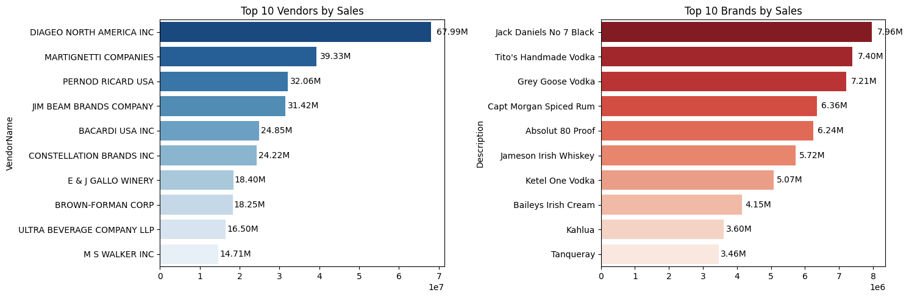
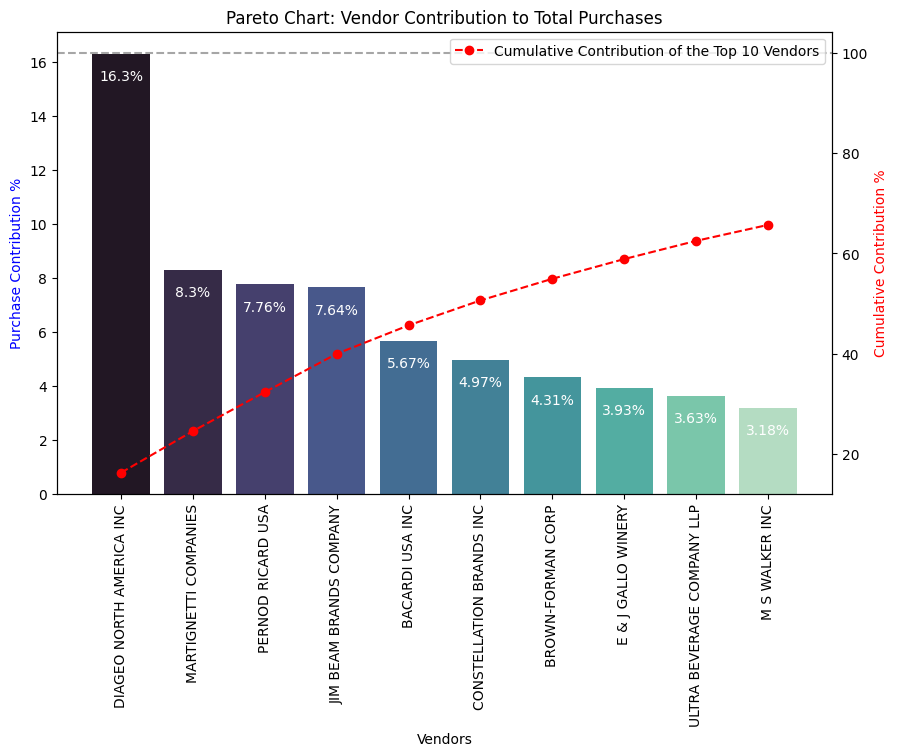
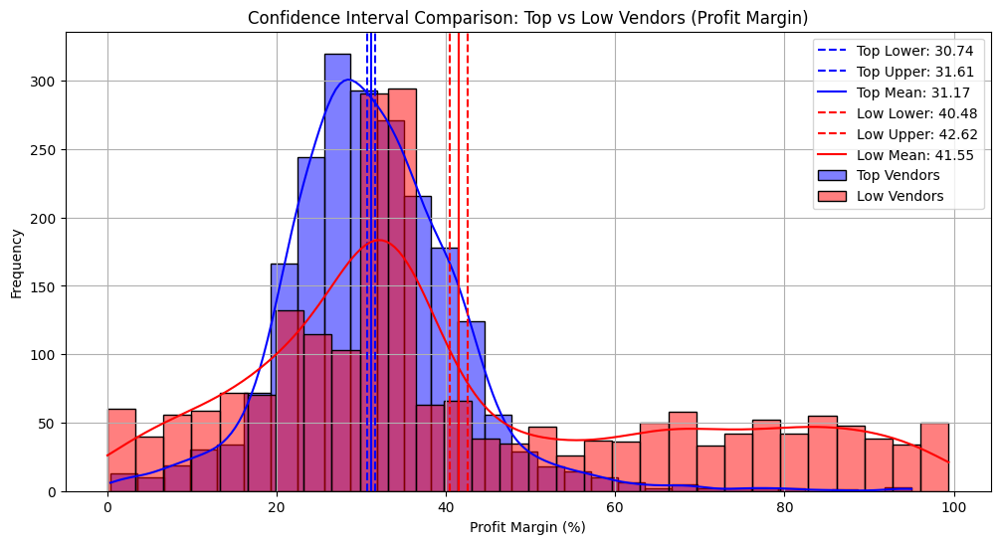

# Vendor Performance Analysis

ETL and analytics pipeline over **15.6M retail transaction records** (sales, purchases, invoices,
inventory) for a multi-store beverage retailer. It answers: *which vendors drive profit, which ones
tie up working capital in stock that does not sell, and where should pricing or purchasing change?*

Raw CSV extracts are loaded into MySQL, joined into a vendor-and-brand summary table, analysed in a
Jupyter notebook with Pandas, SciPy and Seaborn/Plotly, and presented in a Power BI dashboard.

---

## Key results

All figures come from the executed notebook ([`notebooks/vendor_performance_analysis.ipynb`](notebooks/vendor_performance_analysis.ipynb)).

| | |
| :--- | :--- |
| **Data volume** | 15,646,659 rows across 6 source tables (12.8M sales, 2.4M purchases) |
| **Query optimisation** | The naive three-table join ran for over 9 minutes before being cancelled; rewriting it with CTEs that pre-aggregate each table before joining returns the 10,692-row summary in **44 seconds** (original run, Aug 2025; timing varies with MySQL memory settings) |
| **Vendor concentration** | The top 10 of 119 vendors account for **65.7%** of all purchase dollars |
| **Idle capital** | **$3.71M** of inventory was purchased but not sold (largest: Diageo $984K, Jim Beam $761K, Pernod Ricard $647K) |
| **Bulk pricing** | Large orders average **$10.78/unit** vs $39.06 for small orders |
| **Margin gap** | Low-sales vendors earn higher margins (95% CI 40.5–42.6%) than top-sales vendors (30.7–31.6%); Welch's t-test t = −17.6, p < 0.001 |
| **Pricing targets** | Brands with low sales but high margins identified as candidates for promotion or price changes |

### A few vendors dominate sales



### Ten vendors account for two-thirds of purchasing



### Smaller vendors earn higher margins

The 95% confidence intervals for profit margin do not overlap: bottom-quartile vendors by sales
average 41.6%, top-quartile vendors 31.2%. High sales volume is coming at the cost of margin.



---

## Power BI dashboard

[`dashboard/Vendor Performance Dashboard.pbix`](dashboard/Vendor%20Performance%20Dashboard.pbix)
(open with the free [Power BI Desktop](https://www.microsoft.com/en-us/power-platform/products/power-bi/desktop)).
A single page built on the notebook's exports in `data/processed/`:

- **KPI cards:** total sales, total purchases, gross profit, profit margin, unsold capital
- **Purchase contribution** of the top 10 vendors (donut)
- **Top vendors** and **top brands** by sales (bar charts)
- **Low-performing vendors** by stock turnover (funnel)
- **Low-performing brands:** sales vs. profit margin, with promotion/pricing targets highlighted (scatter)

---

## Repository layout

```
src/ingest_db.py                         CSV -> MySQL loader (batched inserts, retries, logging)
notebooks/vendor_performance_analysis.ipynb
                                         EDA, summary-table SQL, vendor metrics, statistics
dashboard/Vendor Performance Dashboard.pbix
                                         Power BI dashboard
data/sample/top_10_vendors.csv           Small output sample (committed)
data/raw/                                Source CSVs (local only, gitignored)
data/processed/                          Notebook exports (local only, gitignored)
tests/                                   Unit tests for the loader
docs/STATUS.md                           Feature status, decisions, known issues, next steps
docs/images/                             Charts used in this README
```

---

## Data

The source CSVs (~1.9 GB) are **not committed**; `sales.csv` alone is 1.5 GB, beyond GitHub's
100 MB file limit. Place them in `data/raw/`:

| File | Rows | Size |
| :--- | ---: | ---: |
| `sales.csv` | 12,825,363 | 1.5 GB |
| `purchases.csv` | 2,372,474 | 345 MB |
| `end_inventory.csv` | 224,489 | 19 MB |
| `begin_inventory.csv` | 206,529 | 17 MB |
| `purchase_prices.csv` | 12,261 | 1 MB |
| `vendor_invoice.csv` | 5,543 | 510 KB |

---

## Running it

Requires Python 3.10+ and a MySQL 8 server.

```bash
git clone https://github.com/ParshvCrafts/Vendor-Performance-Analysis.git
cd Vendor-Performance-Analysis

python -m venv venv && source venv/bin/activate   # Windows: venv\Scripts\activate
pip install -r requirements.txt

cp .env.example .env          # fill in MYSQL_PASSWORD (and the rest if not defaults)
# put the six source CSVs in data/raw/

python src/ingest_db.py       # WARNING: drops and recreates MYSQL_DATABASE
cd notebooks && jupyter notebook vendor_performance_analysis.ipynb
pytest                        # loader unit tests (no database needed)
```

| Variable | Default | Purpose |
| :--- | :--- | :--- |
| `MYSQL_HOST` / `MYSQL_PORT` | `localhost` / `3306` | Database server |
| `MYSQL_USER` | `root` | Database user |
| `MYSQL_PASSWORD` | *(required)* | Database password |
| `MYSQL_DATABASE` | `vendor` | Target database (recreated on each ingest) |
| `DATA_DIR` | `data/raw` | Directory holding the source CSVs |
| `LOG_DIR` | `logs` | Ingestion log output |

The loader creates one table per CSV in `DATA_DIR`, infers column types, inserts in 1,000-row
batches with retry on connection errors, logs to console and `logs/ingest_db.log`, and exits
non-zero if any table fails. The notebook then builds and stores the `vendor_sales_summary` table.

---

## Method

1. **Ingest:** load each CSV into its own MySQL table.
2. **Model:** pre-aggregate freight (invoices), purchases (joined to prices) and sales per vendor and
   brand in CTEs, then join them into one summary table with gross profit, profit margin, stock
   turnover and sales-to-purchase ratio.
3. **Clean:** drop rows with non-positive gross profit, margin or sales quantity.
4. **Analyse:** vendor and brand rankings, purchase contribution (Pareto), order-size unit pricing,
   low-turnover vendors, unsold inventory value, and confidence intervals plus a t-test on margins.
5. **Report:** export the summary and top-10 tables to `data/processed/` for the Power BI dashboard.

---

## License

MIT
